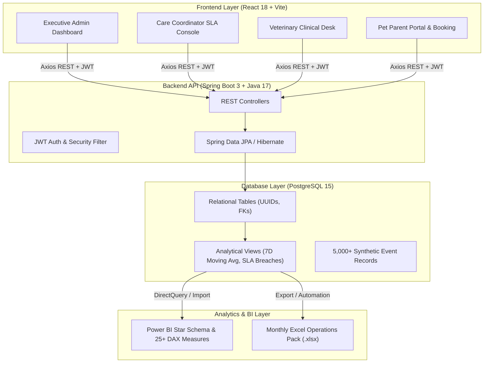

# 🐾 PawPulse — Pet Healthcare Operations & Analytics Platform

[](https://spring.io/projects/spring-boot)
[](https://react.dev)
[](https://www.postgresql.org)
[](https://powerbi.microsoft.com)
[](https://office.com)

PawPulse is an enterprise-grade full-stack operations and clinical analytics platform designed for veterinary hospital networks, mobile clinics, and teleconsultation hubs.

---

## 🏗️ Architecture Overview



---

## 📦 Project Structure

```
pawpulse/
├── backend/                       # Spring Boot 3 Java Backend
│   ├── src/main/java/com/pawpulse/
│   │   ├── config/                # SecurityConfig, JwtFilter, JwtUtil
│   │   ├── controller/            # Dashboard, Appointment, Auth Controllers
│   │   ├── dto/                   # DTOs
│   │   ├── entity/                # Appointment, Clinic, Owner, Payment, Pet, etc.
│   │   ├── repository/            # JPA Repositories
│   │   └── service/               # DashboardService, AuthService
│   ├── src/main/resources/
│   │   ├── application.yml        # Dev (H2) and Prod (PostgreSQL) configurations
│   │   └── data.sql               # Dev seed data
│   └── pom.xml
│
├── frontend/                      # React 18 + Vite Single Page Application
│   ├── src/
│   │   ├── components/            # Sidebar, Navbar, Layout, ProtectedRoute
│   │   ├── context/               # AuthContext with 1-click persona demo logins
│   │   ├── data/                  # syntheticData.js (high-fidelity fallback datasets)
│   │   ├── pages/
│   │   │   ├── LoginPage.jsx      # Role selection cards + credential form
│   │   │   ├── AdminDashboard.jsx # 15 KPIs, Recharts charts, Leaderboards
│   │   │   ├── CoordinatorView.jsx# Referral SLA pipeline & Rx follow-up desk
│   │   │   ├── VetConsole.jsx     # Consult queue & digital Rx generator
│   │   │   ├── OwnerPortal.jsx    # Pet profiles & treatment plans
│   │   │   ├── BookingPage.jsx    # Interactive booking wizard
│   │   │   └── AppointmentsPage.jsx # Multi-filtered master log
│   │   ├── services/              # api.js with JWT interceptor & demo fallback
│   │   └── index.css              # Dark Glassmorphism Design System
│   └── package.json
│
├── sql/                           # PostgreSQL Database & Analytics
│   ├── 01_schema.sql              # DDL schema with constraints & indexes
│   ├── 02_kpi_views.sql           # Real-time analytical SQL views
│   ├── 03_advanced_analytics.sql  # Window functions, LAG, DENSE_RANK, CTEs
│   ├── 04_seed_data.sql           # 5,000+ realistic rows of clinical events
│   └── generate_seed_sql.py       # Python generator for seed data
│
├── powerbi/                       # Power BI Desktop Assets
│   ├── pawpulse_data_model.md     # Star Schema specifications (Kimball)
│   ├── dax_measures.dax           # 25+ production DAX measures
│   └── powerbi_dashboard_guide.md # Report construction manual
│
└── excel/                         # Advanced Excel Management Pack
    ├── PawPulse_Monthly_Operations_Pack.xlsx # Multi-tab formatted management pack
    ├── generate_excel_pack.py     # openpyxl automation script
    └── excel_kpi_workbook_guide.md# SUMIFS, XLOOKUP, Dynamic Arrays guide
```

---

## 🚀 Quick Start Guide

### 1. Run React Frontend
```bash
cd frontend
npm install
npm run dev
```
Open [http://localhost:5173](http://localhost:5173) in your browser.
Click any demo persona card (**Operations Admin**, **Care Coordinator**, **Veterinarian**, or **Pet Parent**) for instant access.

### 2. Run Database & Seed Data
Execute the SQL scripts against PostgreSQL:
```bash
psql -U postgres -d pawpulse -f sql/01_schema.sql
psql -U postgres -d pawpulse -f sql/04_seed_data.sql
psql -U postgres -d pawpulse -f sql/02_kpi_views.sql
```

### 3. Open Excel Management Pack
The pre-generated multi-tab workbook is located at:
`excel/PawPulse_Monthly_Operations_Pack.xlsx`

### 4. Setup Power BI Dashboard
Follow the detailed steps in `powerbi/powerbi_dashboard_guide.md` and import the DAX measures from `powerbi/dax_measures.dax`.
