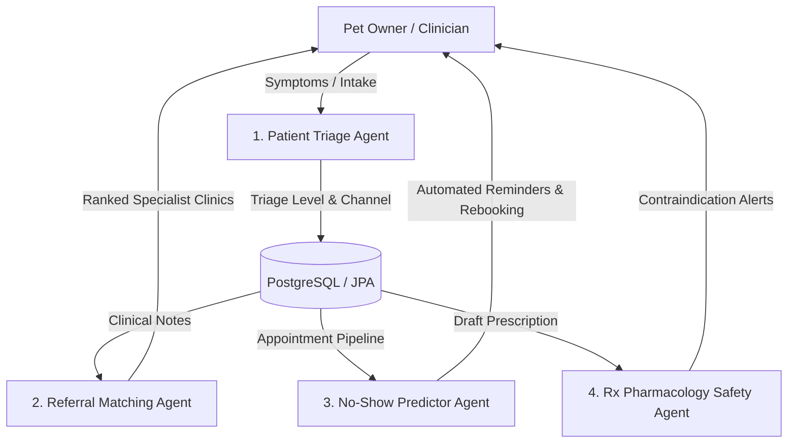

# AI Agent Systems Architecture & Specifications (AGENTS.md) — PawPulse

**System Name**: PawPulse Multi-Agent Clinical Intelligence System  
**Version**: 1.0.0  
**Architect**: Senior AI Agent Systems Architect & Clinical Informatics Specialist  

---

## 1. Agent Topology & System Architecture

PawPulse integrates a specialized network of **4 AI Agents** designed to automate triage, optimize specialist referral routing, suppress no-show churn, and audit pharmacology safety.



---

## 2. Agent Catalog & Specifications

### 2.1 Agent 1: Clinical Triage & Intake Agent (`TriageAgent`)
* **Purpose**: Evaluate pet symptoms entered by pet parents during online booking, assess clinical urgency, and recommend the appropriate consultation channel (`Emergency Clinic`, `Teleconsult`, or `Standard Clinic`).
* **Triggers**: Executed on booking submission (`POST /api/appointments`).
* **MCP Tools Used**: `mcp_pet_symptom_knowledge`, `mcp_clinic_slot_query`.
* **System Prompt Template**:
```text
You are the PawPulse Veterinary Triage Agent. Your objective is to assess pet symptoms 
reported by owners and classify urgency into one of: EMERGENCY, URGENT, ROUTINE.
Rules:
1. Symptoms like severe dyspnea, gastric dilatation-volvulus (GDV) signs in dogs, 
   urinary blockage in male cats, or seizures require IMMEDIATE EMERGENCY CLINIC referral.
2. Mild dermatological issues or routine diet inquiries are suitable for TELECONSULT.
3. Always ask clarifying questions regarding species, breed, and age before final triage.
Output Format: JSON containing { "urgencyLevel", "recommendedChannel", "rationale", "intakeAlerts" }
```

---

### 2.2 Agent 2: Inter-Clinic Referral Matcher (`ReferralMatchAgent`)
* **Purpose**: Analyze clinical notes and diagnostic images from primary care vets, matching the patient to the highest-rated available specialist within a 50km radius.
* **Triggers**: Triggered when a vet clicks "Initiate Referral" in the clinical console.
* **MCP Tools Used**: `mcp_postgres_database_query`, `mcp_vet_capacity_telemetry`.
* **Input Schema**:
```json
{
  "patientId": "d100cf53-d0d1-41a7-948e-858774d721d3",
  "species": "canine",
  "primaryDiagnosis": "Left stifle cranial cruciate ligament rupture",
  "originClinicId": "afdc1951-66e5-45bf-85b9-2ae7d3017d42",
  "requiredSpecialty": "Orthopedics"
}
```
* **Output Schema**:
```json
{
  "recommendedClinics": [
    {
      "clinicId": "41544529-0825-4686-b37b-9f9f1eb0690b",
      "clinicName": "PetFirst Hyderabad",
      "specialist": "Dr. Arjun Reddy",
      "distanceKm": 12.4,
      "earliestSlot": "2026-10-22T10:00:00Z",
      "matchScore": 0.94
    }
  ]
}
```

---

### 2.3 Agent 3: No-Show Predictor & Retention Agent (`NoShowAgent`)
* **Purpose**: Analyze scheduling patterns, past owner attendance history, lead time, and appointment timing to score the likelihood of an appointment no-show.
* **Triggers**: Scheduled batch job running daily at 06:00 UTC for the upcoming 48 hours of bookings.
* **Actions Taken**:
  * Score `> 0.65`: Triggers multi-channel SMS/WhatsApp confirmation prompt with 1-click reschedule.
  * Score `> 0.85`: Flags slot to Clinical Coordinator for soft-overbooking backup.

---

### 2.4 Agent 4: Prescription Pharmacology Auditor (`RxAuditor`)
* **Purpose**: Screen draft veterinary prescriptions against species contraindications, calculating exact weight-adjusted milligram-per-kilogram bounds.
* **Guardrails**:
  * **Absolute Veto**: Acetaminophen (Paracetamol) or Permethrin prescribed to feline patients triggers a hard blocker dialog (`FATAL TOXICITY WARNING`).
  * **Weight Check**: Compares `weightKg` from the pet entity against the recommended mg/kg dosage window.

---

## 3. Human-In-The-Loop (HITL) & Safety Guardrails

1. **No Autonomous Clinical Actions**: Agents cannot finalize prescriptions, cancel confirmed bookings, or alter diagnostic records without explicit authenticated clinician approval.
2. **Deterministic Fallbacks**: If the AI model or MCP server fails, the application automatically defaults to standard heuristic business logic (e.g., standard FIFO queue sorting, standard reminder dispatches).
3. **Audit Trail**: Every agent action, input prompt, and recommendation is logged to the `agent_audit_logs` table with execution latency and model confidence scores.
