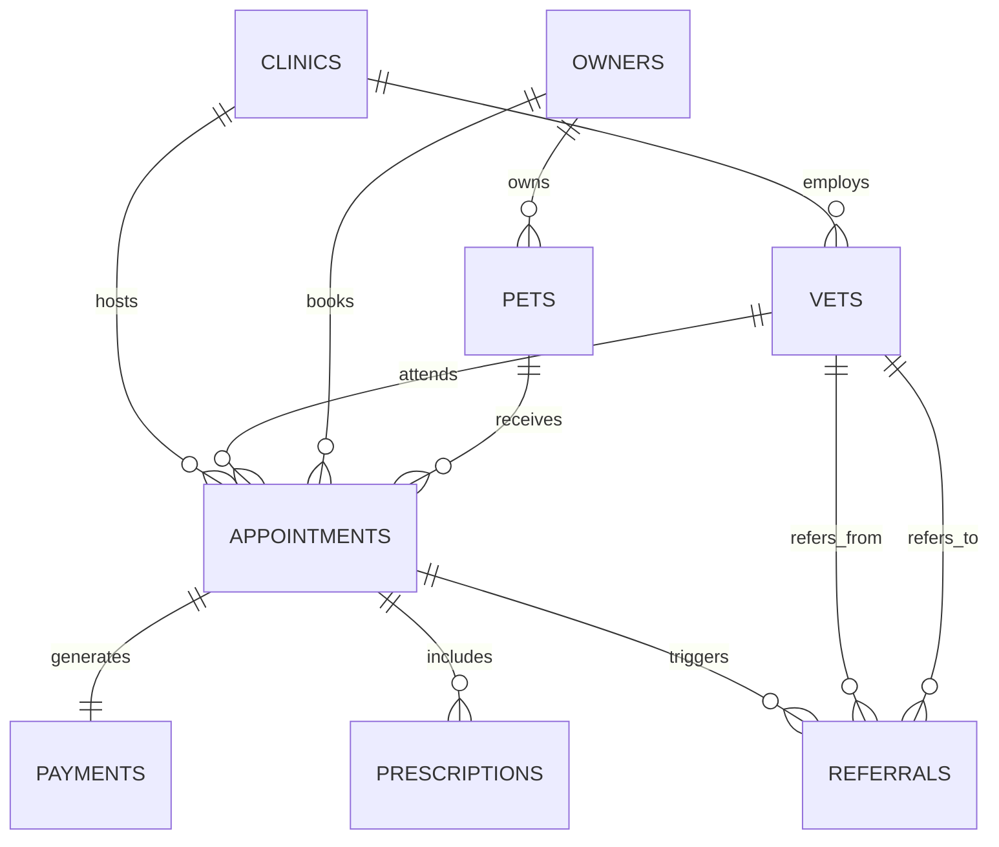

# Database & Backend Implementation Guide (BACKEND.md) — PawPulse

**System Name**: PawPulse Relational Data Engine & Spring Boot Backend  
**Version**: 1.0.0  
**Database**: PostgreSQL 15 / H2 Database Engine  
**Framework**: Spring Boot 3.2.5 (Java 17)  
**Author**: Principal Backend Architect & Database Engineer  

---

## 1. Relational Database Schema Design

The PawPulse database contains **8 core operational tables** designed with strict relational integrity, foreign key cascades, and UUID primary keys.

### 1.1 Entity Relationship Diagram (ERD)



### 1.2 Table Specifications

#### 1. `clinics`
| Column | Type | Constraints | Description |
| :--- | :--- | :--- | :--- |
| `id` | `UUID` | `PRIMARY KEY` | Unique clinic identifier |
| `name` | `VARCHAR(100)` | `NOT NULL` | Clinic commercial name |
| `city` | `VARCHAR(50)` | `NOT NULL` | Operating city (e.g., Mumbai, Pune) |
| `state` | `VARCHAR(50)` | `NULL` | State jurisdiction |
| `type` | `VARCHAR(30)` | `NOT NULL` | Service facility type (`clinic`, `mobile`, `teleconsult`) |
| `created_at` | `TIMESTAMP` | `DEFAULT CURRENT_TIMESTAMP` | Audit creation date |

#### 2. `vets`
| Column | Type | Constraints | Description |
| :--- | :--- | :--- | :--- |
| `id` | `UUID` | `PRIMARY KEY` | Unique veterinarian identifier |
| `clinic_id` | `UUID` | `REFERENCES clinics(id)` | Associated clinic location |
| `name` | `VARCHAR(100)` | `NOT NULL` | Practitioner full name |
| `email` | `VARCHAR(100)` | `UNIQUE, NOT NULL` | Login email handle |
| `specialization` | `VARCHAR(100)` | `NULL` | Clinical discipline (`Surgery`, `Cardiology`, etc.) |
| `password_hash`| `VARCHAR(255)` | `NOT NULL` | BCrypt password hash |
| `role` | `VARCHAR(20)` | `DEFAULT 'VET'` | Security authorization role |
| `rating` | `NUMERIC(2,1)`| `CHECK (rating BETWEEN 1 AND 5)` | Customer satisfaction average |
| `created_at` | `TIMESTAMP` | `DEFAULT CURRENT_TIMESTAMP` | Registration timestamp |

#### 3. `owners`
| Column | Type | Constraints | Description |
| :--- | :--- | :--- | :--- |
| `id` | `UUID` | `PRIMARY KEY` | Pet parent unique identifier |
| `name` | `VARCHAR(100)` | `NOT NULL` | Owner full name |
| `email` | `VARCHAR(100)` | `UNIQUE, NOT NULL` | Primary contact & login email |
| `phone` | `VARCHAR(20)` | `NOT NULL` | Mobile number |
| `password_hash`| `VARCHAR(255)` | `NOT NULL` | BCrypt password hash |
| `city` | `VARCHAR(50)` | `NULL` | Residential city |
| `state` | `VARCHAR(50)` | `NULL` | Residential state |
| `role` | `VARCHAR(20)` | `DEFAULT 'OWNER'` | System role |
| `created_at` | `TIMESTAMP` | `DEFAULT CURRENT_TIMESTAMP` | Account creation timestamp |

#### 4. `pets`
| Column | Type | Constraints | Description |
| :--- | :--- | :--- | :--- |
| `id` | `UUID` | `PRIMARY KEY` | Animal patient identifier |
| `owner_id` | `UUID` | `REFERENCES owners(id) ON DELETE CASCADE` | Linked owner |
| `name` | `VARCHAR(50)` | `NOT NULL` | Pet name |
| `species` | `VARCHAR(30)` | `NOT NULL` | Biological species (`dog`, `cat`, `bird`, `rabbit`, etc.) |
| `breed` | `VARCHAR(50)` | `NULL` | Specific breed pedigree |
| `dob` | `DATE` | `NULL` | Date of birth |
| `weight_kg` | `NUMERIC(5,2)`| `NULL` | Clinical weight in kilograms |
| `created_at` | `TIMESTAMP` | `DEFAULT CURRENT_TIMESTAMP` | Patient registration date |

#### 5. `appointments`
| Column | Type | Constraints | Description |
| :--- | :--- | :--- | :--- |
| `id` | `UUID` | `PRIMARY KEY` | Booking identifier |
| `pet_id` | `UUID` | `REFERENCES pets(id)` | Receiving patient |
| `vet_id` | `UUID` | `REFERENCES vets(id)` | Attending clinician |
| `clinic_id` | `UUID` | `REFERENCES clinics(id)` | Operating facility |
| `service_type` | `VARCHAR(30)` | `NOT NULL` | Delivery channel (`clinic`, `teleconsult`, `home_visit`) |
| `status` | `VARCHAR(20)` | `DEFAULT 'booked'` | Status: `booked`, `completed`, `no_show`, `cancelled` |
| `booked_at` | `TIMESTAMP` | `DEFAULT CURRENT_TIMESTAMP` | Time booking was submitted |
| `scheduled_at` | `TIMESTAMP` | `NOT NULL` | Scheduled consultation start |
| `completed_at` | `TIMESTAMP` | `NULL` | Consultation completion timestamp |
| `notes` | `TEXT` | `NULL` | Clinical observations & triage notes |

#### 6. `payments`
| Column | Type | Constraints | Description |
| :--- | :--- | :--- | :--- |
| `id` | `UUID` | `PRIMARY KEY` | Payment transaction UUID |
| `appointment_id`| `UUID` | `REFERENCES appointments(id)` | Associated visit |
| `owner_id` | `UUID` | `REFERENCES owners(id)` | Billing recipient |
| `amount` | `NUMERIC(10,2)`| `NOT NULL` | Invoice total in INR |
| `currency` | `VARCHAR(3)` | `DEFAULT 'INR'` | Currency code |
| `status` | `VARCHAR(20)` | `DEFAULT 'pending'` | Status: `pending`, `completed`, `refunded` |
| `paid_at` | `TIMESTAMP` | `NULL` | Timestamp payment settled |

#### 7. `prescriptions`
| Column | Type | Constraints | Description |
| :--- | :--- | :--- | :--- |
| `id` | `UUID` | `PRIMARY KEY` | Prescription identifier |
| `appointment_id`| `UUID` | `REFERENCES appointments(id)` | Clinical encounter |
| `vet_id` | `UUID` | `REFERENCES vets(id)` | Prescribing practitioner |
| `medication` | `VARCHAR(150)`| `NOT NULL` | Drug brand and chemical name |
| `dosage` | `VARCHAR(100)`| `NULL` | Dosage instructions (`1 tab twice daily`) |
| `duration_days`| `INTEGER` | `NULL` | Course length in days |
| `uploaded` | `BOOLEAN` | `DEFAULT FALSE` | Uploaded digital Rx document flag |
| `prescribed_at`| `TIMESTAMP` | `DEFAULT CURRENT_TIMESTAMP` | Issuance timestamp |
| `uploaded_at` | `TIMESTAMP` | `NULL` | Document upload verification timestamp |

#### 8. `referrals`
| Column | Type | Constraints | Description |
| :--- | :--- | :--- | :--- |
| `id` | `UUID` | `PRIMARY KEY` | Referral transfer identifier |
| `appointment_id`| `UUID` | `REFERENCES appointments(id)` | Originating visit |
| `from_vet_id` | `UUID` | `REFERENCES vets(id)` | Originating doctor |
| `to_vet_id` | `UUID` | `REFERENCES vets(id)` | Receiving specialist |
| `to_clinic_id` | `UUID` | `REFERENCES clinics(id)` | Receiving specialty hospital |
| `status` | `VARCHAR(20)` | `DEFAULT 'referred'` | Status: `referred`, `accepted`, `completed` |
| `referred_at` | `TIMESTAMP` | `DEFAULT CURRENT_TIMESTAMP` | Transfer submission timestamp |
| `accepted_at` | `TIMESTAMP` | `NULL` | SLA acceptance timestamp |
| `completed_at` | `TIMESTAMP` | `NULL` | Final case resolution timestamp |
| `reason` | `TEXT` | `NULL` | Clinical justification and findings |

---

## 2. Indexing Strategy & Query Optimization

To maintain sub-20ms queries across hundreds of thousands of appointment rows:

```sql
-- 1. Accelerate Appointment Schedule Retrieval
CREATE INDEX idx_appointments_scheduled_at ON appointments(scheduled_at);
CREATE INDEX idx_appointments_vet_scheduled ON appointments(vet_id, scheduled_at);
CREATE INDEX idx_appointments_clinic_status ON appointments(clinic_id, status);

-- 2. Speed up Pet Parent History Lookups
CREATE INDEX idx_pets_owner_id ON pets(owner_id);
CREATE INDEX idx_appointments_pet_id ON appointments(pet_id);

-- 3. Speed up Referral Routing & Auditing
CREATE INDEX idx_referrals_status ON referrals(status);
CREATE INDEX idx_referrals_target_clinic ON referrals(to_clinic_id, status);

-- 4. Financial Reporting Index
CREATE INDEX idx_payments_status_amount ON payments(status, amount);
```

---

## 3. Spring Boot Backend Architecture & Implementation

### 3.1 Core Module Structure
* **`config/`**:
  * `SecurityConfig.java`: Spring Security 6 filter chain, CORS origin patterns, method-level security.
  * `JwtUtil.java`: Token generation, validation, and claim parsing using HMAC-SHA256.
  * `JwtFilter.java`: OncePerRequestFilter parsing `Authorization: Bearer` headers.
* **`controller/`**:
  * `HomeController.java`: Health and root status endpoint (`GET /`).
  * `AuthController.java`: Login verification (`POST /api/auth/login`) and health check (`GET /api/auth/health`).
  * `DashboardController.java`: Aggregated executive KPIs and clinic telemetry (`GET /api/dashboard/kpi`).
  * `AppointmentController.java`: CRUD endpoints for scheduling and triage.
* **`service/`**:
  * `AuthService.java`: BCrypt credential verification and JWT dispatch.
  * `DashboardService.java`: High-performance SQL queries for financial and clinical KPIs.
* **`repository/`**:
  * Spring Data JPA interfaces extending `JpaRepository<T, UUID>` with custom JPQL queries.

### 3.2 Running & Testing Locally
```powershell
# Navigate to backend directory
cd backend

# Build JAR with tests skipped
mvn clean package -DskipTests

# Run Spring Boot service locally on port 8080
java -jar target/pawpulse-api-1.0.0.jar
```
Verify endpoint in terminal:
```powershell
curl http://localhost:8080/api/auth/health
```
Output:
```json
{"service":"PawPulse API","version":"1.0.0","status":"UP"}
```
