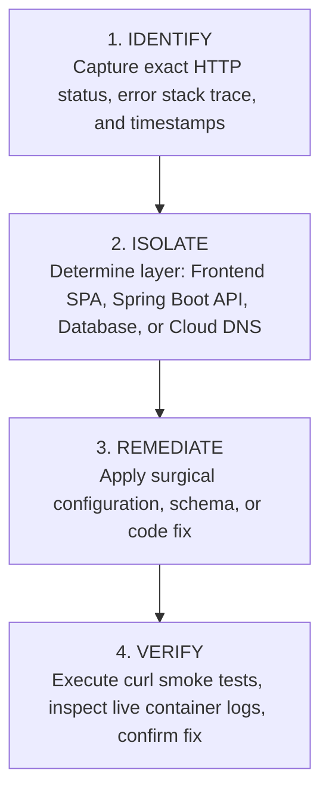

# Debugging, Troubleshooting & Incident Runbooks (DEBUGGING.md) — PawPulse

**System Name**: PawPulse Production Diagnostics & RCA Runbook  
**Version**: 1.0.0  
**Author**: Principal Site Reliability Engineer (SRE) & Systems Debugger  

---

## 1. System Incident Troubleshooting Flow

When diagnosing anomalies in the PawPulse stack, follow the 4-step diagnostic protocol:



---

## 2. Common Issues, Root Causes & Verified Solutions

### 2.1 Issue 1: `HTTP ERROR 403 Forbidden` on Base URL (`/`)
* **Symptom**: Visiting `https://pawpulse-v1df.onrender.com/` in Chrome displays `Access was denied. HTTP ERROR 403`.
* **Root Cause**: Spring Security default configuration specifies `.anyRequest().authenticated()`. When a user navigates to the bare root domain in a browser without an `Authorization: Bearer` header, Spring Security blocks the request.
* **Resolution**:
  1. Add a public root endpoint controller:
     ```java
     @RestController
     public class HomeController {
         @GetMapping("/")
         public ResponseEntity<Map<String, Object>> root() {
             return ResponseEntity.ok(Map.of("service", "PawPulse API", "status", "UP"));
         }
     }
     ```
  2. Permit the root path in `SecurityConfig.java`:
     ```java
     .requestMatchers("/", "/api/auth/**").permitAll()
     ```

---

### 2.2 Issue 2: `JdbcSQLIntegrityConstraintViolationException: NULL not allowed for column "CREATED_AT"`
* **Symptom**: Spring Boot application crashes during startup while executing `data.sql`.
* **Root Cause**: Entity classes (e.g., `Clinic.java`, `Vet.java`) declared `@Column(nullable = false)` on audit columns. When raw SQL statements in `data.sql` omitted these columns, H2 rejected the inserts with constraint violations.
* **Resolution**:
  1. In entity definitions, remove `nullable = false` from auto-generated audit columns.
  2. In `data.sql`, update all `INSERT INTO clinics` statements to explicitly include `created_at` (`CURRENT_TIMESTAMP`) and `role` (`'VET'`, `'OWNER'`).
  3. In `application.yml`, enable `spring.sql.init.continue-on-error: true` as a safeguard.

---

### 2.3 Issue 3: Render Reports `No open ports detected, continuing to scan...`
* **Symptom**: Render deployment times out and marks the web service failed with exit status 1.
* **Root Cause**: Either Spring Boot encountered an unhandled exception before Tomcat finished initializing, or the application was hardcoded to listen on port `8080` while Render routed to a dynamic `$PORT` (e.g., `10000`).
* **Resolution**:
  1. Configure dynamic port binding in `application.yml`:
     ```yaml
     server:
       port: ${PORT:8080}
     ```
  2. In Dockerfile, use shell form to evaluate the environment variable:
     ```dockerfile
     ENTRYPOINT ["sh", "-c", "java -Dserver.port=${PORT:-8080} -jar app.jar"]
     ```

---

### 2.4 Issue 4: Vercel Displays `Login - Vercel` Authentication Screen
* **Symptom**: Opening `https://pawpulse-...vercel.app` prompts visitors to log in to Vercel instead of showing the dashboard.
* **Root Cause**: Vercel's "Deployment Protection" was enabled on the project by default.
* **Resolution**:
  1. Open project settings on Vercel: `Project Settings` → `Deployment Protection`.
  2. Set **Vercel Authentication** to **Disabled**.
  3. Save changes. The URL becomes immediately accessible worldwide.

---

### 2.5 Issue 5: CORS Blocked with `Access-Control-Allow-Origin` Error
* **Symptom**: Browser console throws `Cross-Origin Request Blocked` when frontend calls backend API.
* **Root Cause**: Spring Security's `allowedOrigins` does not permit wildcard `*` when `allowCredentials(true)` is enabled.
* **Resolution**:
  Use `setAllowedOriginPatterns` instead of `setAllowedOrigins`:
  ```java
  CorsConfiguration config = new CorsConfiguration();
  config.setAllowedOriginPatterns(List.of("*"));
  config.setAllowedMethods(List.of("GET", "POST", "PUT", "DELETE", "OPTIONS"));
  config.setAllowCredentials(true);
  ```

---

## 3. Log Inspection Commands

### Inspecting Render Production Logs
```powershell
# Using Render CLI or Web Dashboard
# Look for lines confirming Spring context initialization:
Started PawPulseApplication in 144.205 seconds
==> Your service is live 🎉
```

### Inspecting Local Dev Logs
```powershell
# PowerShell log tailing for Spring Boot
Get-Content -Path backend/spring.log -Tail 50 -Wait
```

### Inspecting Vite Network Calls in Chrome
* Open Chrome DevTools (`F12` or `Ctrl + Shift + I`).
* Navigate to the **Network** tab → filter by **Fetch/XHR**.
* Confirm HTTP `200` responses on `/api/dashboard/kpi` and check the `Authorization: Bearer` header under Request Headers.
