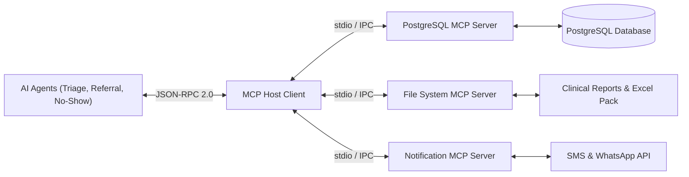

# Model Context Protocol (MCP) Integration Guide (MCP.md) — PawPulse

**System Name**: PawPulse Model Context Protocol (MCP) Connectivity Layer  
**Version**: 1.0.0  
**Specification**: Model Context Protocol v2024.11  
**Author**: Senior AI/MCP Integration Architect  

---

## 1. Overview of MCP in PawPulse

The **Model Context Protocol (MCP)** provides a secure, standardized interface enabling AI agents to interact directly with internal databases, clinical file stores, and communication gateways without exposing raw credentials or direct operating system handles.



---

## 2. MCP Server Configuration

The MCP servers are declared in the workspace configuration file (`mcp_config.json`):

```json
{
  "mcpServers": {
    "pawpulse-postgres": {
      "command": "npx",
      "args": ["-y", "@modelcontextprotocol/server-postgres", "${DATABASE_URL}"],
      "env": {
        "MAX_POOL_SIZE": "10",
        "STATEMENT_TIMEOUT_MS": "5000"
      }
    },
    "pawpulse-filesystem": {
      "command": "npx",
      "args": [
        "-y", 
        "@modelcontextprotocol/server-filesystem", 
        "C:\\Users\\soham\\.gemini\\antigravity-ide\\scratch\\pawpulse\\excel",
        "C:\\Users\\soham\\.gemini\\antigravity-ide\\scratch\\pawpulse\\sql"
      ]
    },
    "pawpulse-notifications": {
      "command": "node",
      "args": ["./scripts/mcp-notification-server.js"],
      "env": {
        "SMS_PROVIDER": "TWILIO",
        "TWILIO_ACCOUNT_SID": "${TWILIO_SID}",
        "TWILIO_AUTH_TOKEN": "${TWILIO_TOKEN}"
      }
    }
  }
}
```

---

## 3. Tool Catalog Exposed by MCP Servers

### 3.1 `pawpulse-postgres`
* **`query_daily_vet_schedule(vetId, date)`**:
  * Returns appointment slot utilization, patient breed, and reason for visit.
* **`calculate_kpi_aggregate(clinicId, dateRange)`**:
  * Executes read-only aggregation queries against `v_monthly_revenue` and returns JSON summary.
* **`find_specialist_clinics(specialty, maxDistanceKm)`**:
  * Searches registered clinics employing specialists matching the target clinical discipline.

### 3.2 `pawpulse-filesystem`
* **`read_excel_operations_pack()`**:
  * Reads financial workbooks ([PawPulse_Monthly_Operations_Pack.xlsx](file:///C:/Users/soham/.gemini/antigravity-ide/scratch/pawpulse/excel/PawPulse_Monthly_Operations_Pack.xlsx)) for executive summary extraction.
* **`export_patient_medical_history(petId)`**:
  * Writes encrypted PDF/Markdown summary of vaccination and consultation history.

### 3.3 `pawpulse-notifications`
* **`dispatch_appointment_reminder(phoneNumber, appointmentDetails)`**:
  * Transmits automated SMS reminder 24 hours prior to scheduled consultation.
* **`dispatch_referral_alert(targetVetEmail, referralDetails)`**:
  * Notifies receiving specialist of urgent pending case transfer.

---

## 4. Example MCP Tool Call Execution

```json
// Request from ReferralMatchAgent via MCP
{
  "jsonrpc": "2.0",
  "id": "req-042",
  "method": "tools/call",
  "params": {
    "name": "find_specialist_clinics",
    "arguments": {
      "specialty": "Orthopedics",
      "maxDistanceKm": 25
    }
  }
}

// Response from pawpulse-postgres MCP server
{
  "jsonrpc": "2.0",
  "id": "req-042",
  "result": {
    "content": [
      {
        "type": "text",
        "text": "[{\"clinicId\":\"41544529-0825-4686-b37b-9f9f1eb0690b\",\"name\":\"PetFirst Hyderabad\",\"doctor\":\"Dr. Arjun Reddy\",\"rating\":4.6,\"openSlotsToday\":3}]"
      }
    ]
  }
}
```

---

## 5. Security Guardrails & Sandboxing

1. **Read-Only Database Credentials**: The `pawpulse-postgres` MCP server operates with read-only database roles (`SELECT` permissions only). Any `DROP`, `UPDATE`, `ALTER`, or `DELETE` queries are rejected at the protocol layer.
2. **Directory Sandboxing**: The filesystem server is constrained to predefined paths (`excel/`, `sql/`) and cannot traverse outside the workspace.
3. **Execution Timeouts**: All MCP tool invocations enforce a strict 5000ms timeout to prevent hanging asynchronous threads.
