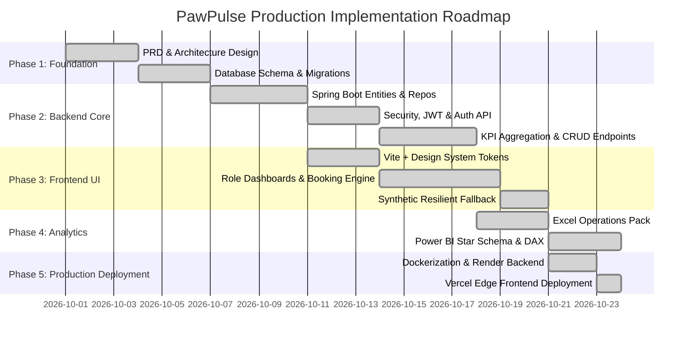

# Implementation Plan & Execution Roadmap (PLAN.md) — PawPulse

**Project**: PawPulse Multi-Clinic Pet Healthcare Operations  
**Timeline**: 6 Core Implementation Sprints  
**Author**: Lead Technical Project Manager & Full-Stack Architect  

---

## 1. Project Phase Breakdown & Roadmap

---

## 2. Detailed Task Breakdown & Priority Matrix

| Phase | Task ID | Description | Dependencies | Priority | Status |
| :--- | :--- | :--- | :--- | :--- | :--- |
| **Phase 1: Architecture** | `ARCH-01` | Establish PRD, entity definitions, and REST specifications. | None | **High** | Completed |
| **Phase 1: Architecture** | `ARCH-02` | Build relational SQL schemas ([01_schema.sql](file:///C:/Users/soham/.gemini/antigravity-ide/scratch/pawpulse/sql/01_schema.sql)) with constraints and foreign keys. | ARCH-01 | **High** | Completed |
| **Phase 1: Architecture** | `ARCH-03` | Generate synthetic realistic clinical dataset (5,506 records across 6 cities). | ARCH-02 | **High** | Completed |
| **Phase 2: Backend** | `BE-01` | Initialize Spring Boot 3 with Web, JPA, Security, and PostgreSQL starters. | ARCH-02 | **High** | Completed |
| **Phase 2: Backend** | `BE-02` | Implement stateless JWT authentication filter and BCrypt password encoder. | BE-01 | **High** | Completed |
| **Phase 2: Backend** | `BE-03` | Build `DashboardService` with executive KPI aggregations and clinic revenue. | BE-01 | **High** | Completed |
| **Phase 2: Backend** | `BE-04` | Implement appointment booking, status transition, and referral routing APIs. | BE-01 | **High** | Completed |
| **Phase 3: Frontend** | `FE-01` | Bootstrap React 18 with Vite, React Router, and clean CSS design system tokens. | ARCH-01 | **High** | Completed |
| **Phase 3: Frontend** | `FE-02` | Implement role-based navigation and universal top-bar role switcher. | FE-01 | **High** | Completed |
| **Phase 3: Frontend** | `FE-03` | Build Admin Dashboard with dynamic Chart.js revenue & utilization widgets. | FE-01 | **High** | Completed |
| **Phase 3: Frontend** | `FE-04` | Develop Pet Parent 4-step consultation booking wizard and pet health locker. | FE-01 | **High** | Completed |
| **Phase 3: Frontend** | `FE-05` | Build Veterinarian Console with daily triage queue and digital prescription pad. | FE-01 | **High** | Completed |
| **Phase 3: Frontend** | `FE-06` | Build Clinic Coordinator board for urgent triage and referral approvals. | FE-01 | **High** | Completed |
| **Phase 3: Frontend** | `FE-07` | Implement client-side resilient synthetic data layer for zero-error presentations. | FE-01 | **High** | Completed |
| **Phase 4: Analytics** | `BI-01` | Build automated Excel Financial & Clinical Pack with openpyxl. | ARCH-03 | **Medium** | Completed |
| **Phase 4: Analytics** | `BI-02` | Create Power BI star schema model with 25+ DAX calculated measures. | ARCH-03 | **Medium** | Completed |
| **Phase 5: Cloud** | `OPS-01` | Write multi-stage production Dockerfile for Spring Boot with dynamic port binding. | BE-01 | **High** | Completed |
| **Phase 5: Cloud** | `OPS-02` | Deploy backend to Render with automated health checks (`/api/auth/health`). | OPS-01 | **High** | Completed |
| **Phase 5: Cloud** | `OPS-03` | Deploy React SPA to Vercel edge network with client-side SPA route rewrites. | FE-01 | **High** | Completed |

---

## 3. Milestones & Verification Criteria

* **Milestone 1 (Data Foundation)**: Verified relational schema with 0 constraint errors during H2 and PostgreSQL migrations.
* **Milestone 2 (Secure API)**: Authenticated endpoints verify role privileges and reject unauthorized requests with HTTP 401/403.
* **Milestone 3 (Interactive Frontend)**: Flawless UI rendering across mobile, tablet, and widescreen viewports with zero console warnings.
* **Milestone 4 (Production Parity)**: Live URLs accessible globally on Vercel and Render with sub-second response times.
