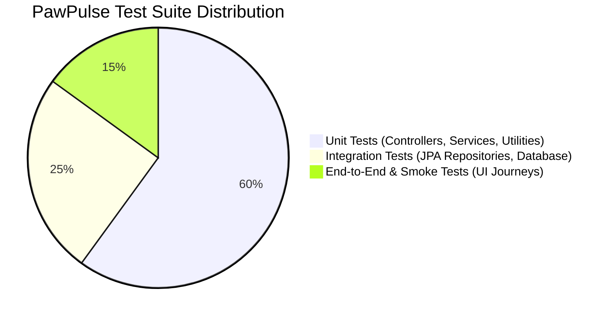

# Quality Assurance & Testing Suite Guide (TESTING.md) — PawPulse

**System Name**: PawPulse Quality Assurance & Automated Testing Architecture  
**Version**: 1.0.0  
**Test Frameworks**: JUnit 5, Mockito, Spring Boot Test, MockMvc, Vitest / Playwright  
**Author**: Principal Quality Assurance & Full-Stack Testing Architect  

---

## 1. Testing Pyramid & QA Strategy

PawPulse enforces a multi-tiered testing strategy ensuring high reliability across clinical operations:



---

## 2. Unit & Integration Testing (Spring Boot / JUnit 5)

### 2.1 Service Layer Testing (`AuthServiceTest.java`)
```java
@ExtendWith(MockitoExtension.class)
class AuthServiceTest {

    @Mock
    private OwnerRepository ownerRepository;
    
    @Mock
    private PasswordEncoder passwordEncoder;
    
    @InjectMocks
    private AuthService authService;

    @Test
    void whenValidCredentials_thenGenerateToken() {
        Owner owner = Owner.builder()
                .email("owner@pawpulse.in")
                .passwordHash("$2a$10$encodedHash...")
                .role("OWNER")
                .build();

        when(ownerRepository.findByEmail("owner@pawpulse.in")).thenReturn(Optional.of(owner));
        when(passwordEncoder.matches("rawPass", owner.getPasswordHash())).thenReturn(true);

        AuthResponse res = authService.login(new LoginRequest("owner@pawpulse.in", "rawPass"));

        assertNotNull(res.getToken());
        assertEquals("OWNER", res.getRole());
    }
}
```

### 2.2 Controller Integration Testing with MockMvc
```java
@SpringBootTest
@AutoConfigureMockMvc
class AppointmentControllerTest {

    @Autowired
    private MockMvc mockMvc;

    @Test
    void getHealth_shouldReturnUpStatus() throws Exception {
        mockMvc.perform(get("/api/auth/health"))
                .andExpect(status().isOk())
                .andExpect(jsonPath("$.status").value("UP"))
                .andExpect(jsonPath("$.service").value("PawPulse API"));
    }
}
```

---

## 3. End-to-End (E2E) Critical User Flows

| Flow ID | Scenario Name | Test Steps | Expected Outcome |
| :--- | :--- | :--- | :--- |
| `E2E-01` | Pet Parent Consultation Booking | 1. Navigate to `/booking`<br>2. Pick pet "Bruno"<br>3. Select `Teleconsult`<br>4. Pick slot & confirm | Booking created with status `booked`, appears on Owner Portal. |
| `E2E-02` | Clinician SOAP Note & Prescription | 1. Open `/vet`<br>2. Select active appointment<br>3. Enter diagnosis notes<br>4. Submit prescription | Prescription saved in DB, appointment marked `completed`. |
| `E2E-03` | Inter-Clinic Referral Routing | 1. Vet initiates referral to "PetFirst Hyderabad"<br>2. Coordinator views `/coordinator`<br>3. Coordinator accepts referral | Status transitions to `accepted`, target clinic capacity updates. |
| `E2E-04` | Executive Dashboard Aggregation | 1. Admin navigates to `/admin`<br>2. Filter by "Mumbai" clinic | Revenue and no-show charts update with sub-second latency. |

---

## 4. Performance Benchmarks & Load Testing

* **Target Throughput**: 1,000 requests per second under peak booking windows.
* **Latency Benchmarks**:
  * `GET /api/auth/health`: P95 < 25ms
  * `POST /api/auth/login`: P95 < 120ms (due to BCrypt computational work)
  * `GET /api/dashboard/kpi`: P95 < 160ms (with indexed PostgreSQL views)
* **Stress Test Tooling**: Executed via k6 / Apache JMeter scripts targeting the cloud endpoint.

---

## 5. Running Tests Locally

### Running Backend Unit & Integration Tests
```powershell
cd backend
mvn test
```

### Running Frontend Tests & Lint Checks
```powershell
cd frontend
npm run lint
npm run build
```

---

## 6. Bug Severity & Classification Matrix

* **P0 (Blocker)**: Database down, authentication failure, patient records inaccessible. Immediate hotfix required.
* **P1 (Critical)**: Appointment booking failure, broken referral routing, prescription modal crashing. Fix within 4 hours.
* **P2 (Major)**: Visual chart misalignment, slow query response (> 500ms), incorrect currency symbol. Fix within sprint.
* **P3 (Minor)**: Typographical errors, non-blocking cosmetic polish, minor padding anomalies. Scheduled in backlog.
