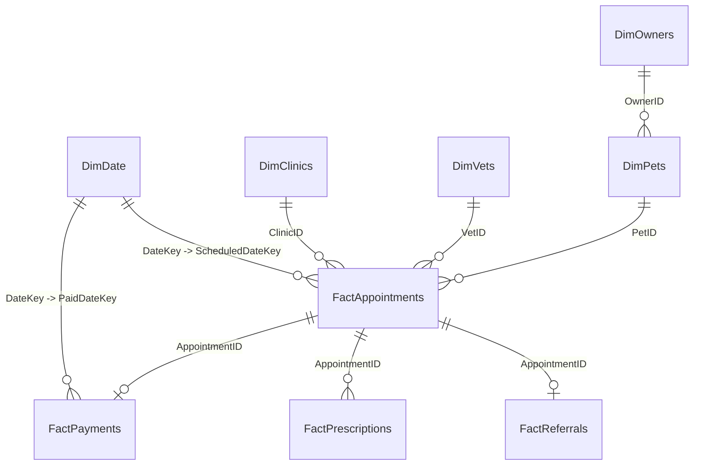

# 📊 PawPulse Power BI Semantic Model & Star Schema Architecture

## 1. Architectural Overview

The PawPulse Power BI reporting suite is designed around an enterprise **Star Schema (Kimball Methodology)**, separating high-velocity numerical facts from analytical dimensions. This design maximizes VertiPaq engine compression in Power BI and ensures sub-second DirectQuery performance against PostgreSQL.

---

## 2. Table Specifications

### Fact Tables

#### `FactAppointments` (Grain: One row per booked appointment)
| Column Name | Data Type | Description | Foreign Key |
|---|---|---|---|
| `AppointmentID` | GUID / Text | Unique consultation identifier (PK) | - |
| `PetID` | GUID / Text | Patient foreign key | `DimPets[PetID]` |
| `VetID` | GUID / Text | Attending veterinarian foreign key | `DimVets[VetID]` |
| `ClinicID` | GUID / Text | Hosting clinic foreign key | `DimClinics[ClinicID]` |
| `ServiceType` | Text | 'teleconsult', 'home_visit', 'clinic' | - |
| `Status` | Text | 'booked', 'completed', 'no_show', 'cancelled' | - |
| `ScheduledDateKey` | Integer | YYYYMMDD integer date key | `DimDate[DateKey]` |
| `ScheduledDateTime` | DateTime | Timestamp of scheduled appointment | - |
| `BookedDateTime` | DateTime | Timestamp of initial booking | - |
| `CompletedDateTime` | DateTime | Timestamp when doctor finished visit | - |
| `LeadTimeHours` | Decimal | Calculated lead time before visit | - |
| `DurationMinutes` | Integer | Consult duration | - |

#### `FactPayments` (Grain: One row per financial settlement)
| Column Name | Data Type | Description | Foreign Key |
|---|---|---|---|
| `PaymentID` | GUID / Text | Primary key | - |
| `AppointmentID` | GUID / Text | Associated consultation | `FactAppointments[AppointmentID]` |
| `OwnerID` | GUID / Text | Payer foreign key | `DimOwners[OwnerID]` |
| `PaidDateKey` | Integer | YYYYMMDD date key | `DimDate[DateKey]` |
| `PaidDateTime` | DateTime | Settlement timestamp | - |
| `AmountINR` | Currency / Decimal | Amount billed in Indian Rupees | - |
| `Currency` | Text | Currency code ('INR') | - |
| `PaymentStatus` | Text | 'completed', 'pending', 'refunded' | - |

#### `FactReferrals` (Grain: One row per specialist handoff)
| Column Name | Data Type | Description | Foreign Key |
|---|---|---|---|
| `ReferralID` | GUID / Text | Primary key | - |
| `AppointmentID` | GUID / Text | Originating consultation | `FactAppointments[AppointmentID]` |
| `FromVetID` | GUID / Text | Referring doctor | `DimVets[VetID]` |
| `ToVetID` | GUID / Text | Receiving specialist | `DimVets[VetID]` |
| `ToClinicID` | GUID / Text | Destination clinic | `DimClinics[ClinicID]` |
| `ReferralStatus` | Text | 'referred', 'accepted', 'completed' | - |
| `ReferredDateTime` | DateTime | Timestamp referral was issued | - |
| `AcceptedDateTime` | DateTime | Timestamp receiving clinic confirmed | - |
| `TATHours` | Decimal | `AcceptedDateTime - ReferredDateTime` in hours | - |
| `IsBreachedSLA` | Boolean | True if TATHours > 4.0 | - |

#### `FactPrescriptions` (Grain: One row per prescribed medication item)
| Column Name | Data Type | Description | Foreign Key |
|---|---|---|---|
| `PrescriptionID` | GUID / Text | Primary key | - |
| `AppointmentID` | GUID / Text | Associated consult | `FactAppointments[AppointmentID]` |
| `VetID` | GUID / Text | Prescribing vet | `DimVets[VetID]` |
| `MedicationName` | Text | Brand/generic name | - |
| `Dosage` | Text | Regimen & frequency | - |
| `DurationDays` | Integer | Course duration | - |
| `IsUploaded` | Boolean | Digital copy submitted to portal | - |
| `PrescribedDateTime` | DateTime | Timestamp issued | - |
| `UploadedDateTime` | DateTime | Timestamp uploaded | - |

---

### Dimension Tables

#### `DimDate` (Calendar Dimension)
- `DateKey` (PK, YYYYMMDD)
- `FullDate` (Date)
- `Year`, `Quarter`, `MonthName`, `MonthNumber`, `WeekNumber`, `DayOfWeek`, `DayName`
- `IsWeekend`, `IsCurrentMonth`, `IsPrior30Days`

#### `DimClinics`
- `ClinicID` (PK)
- `ClinicName`, `City`, `State`, `FacilityType` ('clinic', 'mobile', 'teleconsult')

#### `DimVets`
- `VetID` (PK)
- `VetName`, `Specialization`, `Email`, `Rating`

#### `DimPets`
- `PetID` (PK)
- `OwnerID` (FK to `DimOwners`)
- `PetName`, `Species` ('dog', 'cat', 'bird', 'other'), `Breed`, `DOB`, `AgeYears`, `WeightKg`

#### `DimOwners`
- `OwnerID` (PK)
- `OwnerName`, `Email`, `Phone`, `City`, `State`
